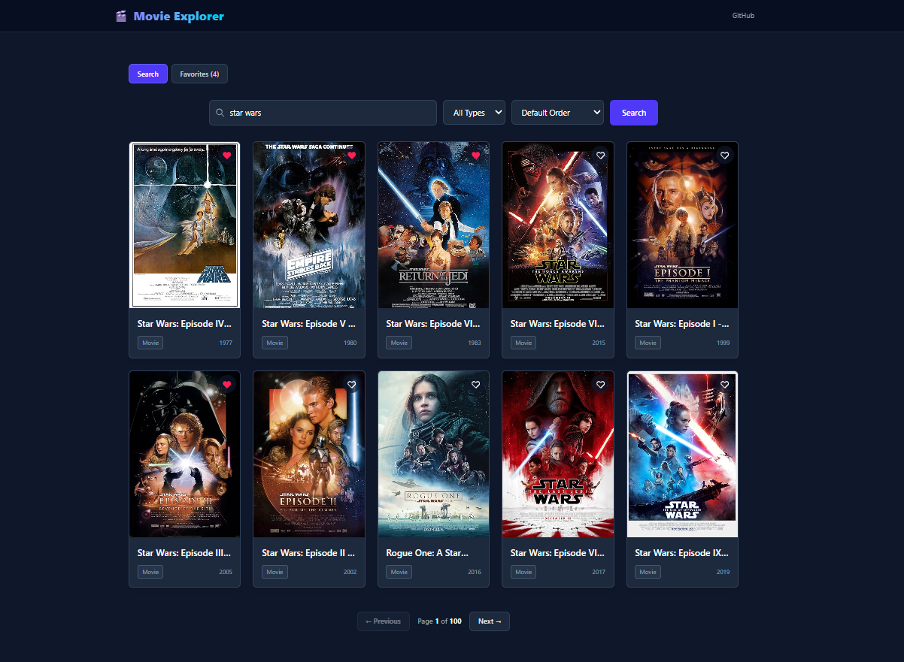
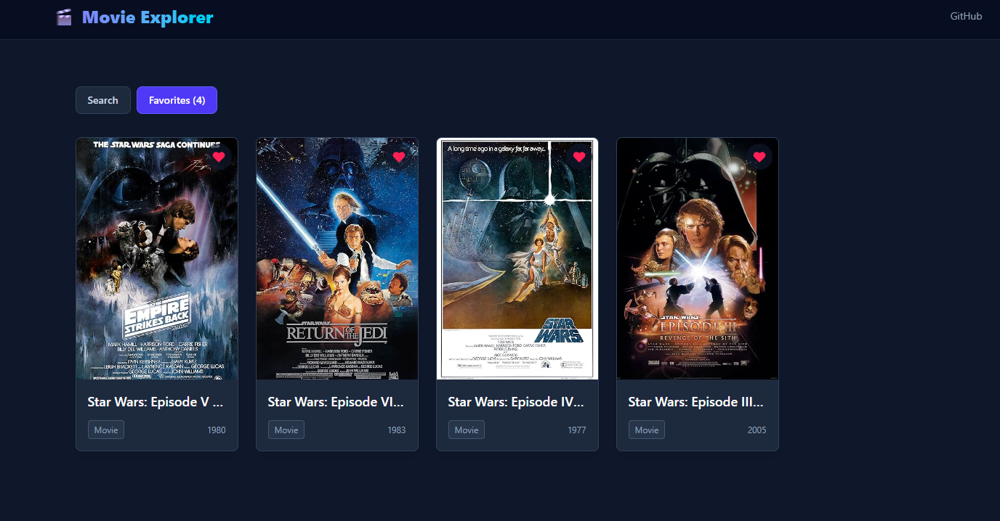
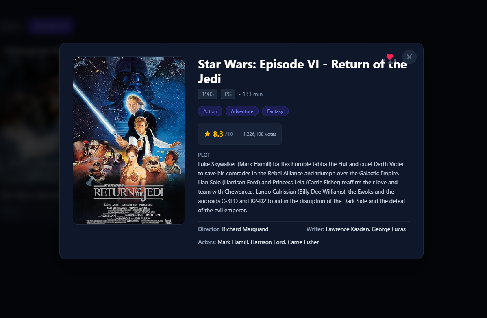

# 🎬 Movie Explorer App

A modern, responsive React 19 application for searching movies, series, and episodes using the OMDB API. Features server-side pagination, sorting, content filtering, debouncing, and a favorites list persisted in the browser.

🚀 **Live Demo:** [https://movie-explorer-app-beta.vercel.app/](https://movie-explorer-app-beta.vercel.app/)

---

## 📸 Screenshots

|            Search & Filtering            |               Favorites Tab                |               Movie Details Modal                |
| :--------------------------------------: | :----------------------------------------: | :----------------------------------------------: |
|  |  |  |

---

## ✨ Features

- **Debounced Search:** Custom hook implementation to limit API calls during typing.
- **Filtering & Sorting:** Filter by content type (Movies, Series, Episodes) and sort results by release year. Sorting is applied client-side to the current page of results, since the OMDB API does not support it.
- **Server-Side Pagination:** Smooth navigation between search result pages with automatic scroll-to-top.
- **Favorites:** Save movies with a heart button on the cards or in the details modal, and browse them in a dedicated Favorites tab. Persisted in `localStorage` through a reusable, generic `useLocalStorage` hook.
- **Movie Details Modal:** Fetch detailed metadata (Plot, Cast, Ratings, Runtime) via TanStack Query.
- **Responsive Layout:** Built with Tailwind CSS v4, fully adaptable for desktop and mobile devices.
- **Type Safety:** Strict TypeScript interfaces for API responses and component props.

---

## 🛠️ Tech Stack & Architecture

- **Framework & Build Tool:** React 19, Vite, TypeScript
- **State & Data Fetching:** TanStack Query v5, Axios
- **Styling:** Tailwind CSS v4
- **Code Quality:** ESLint, Prettier, Husky + lint-staged (lint and format on every commit)
- **Performance Patterns:**
  - `useDebounce` hook for rate-limiting search requests.
  - `useMemo` for client-side sorting without redundant recalculations.
  - `useRef` (Latest Ref pattern) for stable callback references in search effects.
  - `useCallback` for stable favorite handlers.

---

## 🚀 Getting Started Locally

### Prerequisites

- Node.js (v20.19 or higher)
- npm
- A free OMDB API key from [omdbapi.com](https://www.omdbapi.com/apikey.aspx)

### Installation

1. **Clone the repository:**

```bash
   git clone https://github.com/nickdimizas/movie-explorer-app.git
   cd movie-explorer-app
```

2. **Install dependencies:**

```bash
   npm install
```

3. **Set up environment variables:** create a `.env` file in the root directory and add your OMDB API key:

```env
   VITE_OMDB_API_KEY=your_api_key_here
```

> Vite exposes `VITE_` variables in the client bundle, so use a free demo key only. A production app would proxy the requests through a backend.

4. **Run the development server:**

```bash
   npm run dev
```

The app will be available at `http://localhost:5173`.

### Available Scripts

| Script            | Description                           |
| :---------------- | :------------------------------------ |
| `npm run dev`     | Start the development server          |
| `npm run build`   | Type-check and build for production   |
| `npm run preview` | Preview the production build locally  |
| `npm run lint`    | Run ESLint on the whole project       |
| `npm run format`  | Format the `src` folder with Prettier |

---

## 📁 Project Structure

```text
src/
├── apis/              # OMDB API calls (movies.ts)
├── components/
│   ├── layout/        # Header, Footer, MainLayout
│   ├── movies/        # MovieGrid, MovieCard, MovieDetailsModal, MovieSearchContainer
│   └── ui/            # SearchBar, Pagination, FavoriteButton
├── hooks/             # Custom hooks (useMovies, useDebounce, useFavorites, useLocalStorage)
└── types/             # TypeScript definitions
```

---

## 👤 Author

**Nikos Dimizas** – [GitHub](https://github.com/nickdimizas) · [LinkedIn](https://www.linkedin.com/in/nikos-dimizas-144ba6385/)
